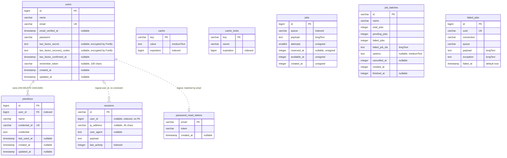

# Entity-relationship diagram

Every table created by `database/migrations/*`, in PostgreSQL (the `pgsql` connection). Types are the
Laravel Blueprint types as PostgreSQL stores them (`string` is `varchar(255)`, `id()` is a `bigserial`
primary key, `timestamp` is `timestamp(0) without time zone`). A column marked `nullable` lacks
`NOT NULL`; everything else is `NOT NULL`.

## Which tables the current configuration uses

| Table                   | Used now                                                                                                                                                                       |
| ----------------------- | ------------------------------------------------------------------------------------------------------------------------------------------------------------------------------ |
| `users`                 | Yes (PostgreSQL).                                                                                                                                                              |
| `password_reset_tokens` | Yes (PostgreSQL): `config/auth.php` password broker `users`.                                                                                                                   |
| `passkeys`              | Yes (PostgreSQL).                                                                                                                                                              |
| `sessions`              | No. `SESSION_DRIVER=redis` (config/session.php), sessions live in Redis.                                                                                                       |
| `cache`, `cache_locks`  | No. `CACHE_STORE=redis` (config/cache.php), cache and locks live in Redis.                                                                                                     |
| `jobs`                  | No. `QUEUE_CONNECTION=rabbitmq` (config/queue.php), jobs live in RabbitMQ.                                                                                                     |
| `failed_jobs`           | Yes (PostgreSQL): `queue.failed` is `database-uuids` on the `DB_CONNECTION` connection, table `failed_jobs`.                                                                   |
| `job_batches`           | Yes (PostgreSQL): `queue.batching` points at the `DB_CONNECTION` connection, table `job_batches`. Only written when a job batch is dispatched; no code dispatches batches yet. |

The unused tables (`sessions`, `cache`, `cache_locks`, `jobs`) come from Laravel's default migrations and
are kept so that switching `SESSION_DRIVER`, `CACHE_STORE` or `QUEUE_CONNECTION` to `database` works
without a new migration.

## Tables

### users

Accounts. `email` is unique and lowercased by Fortify (`lowercase_usernames`). `email_verified_at` is
`null` until the verification link is used and is reset to `null` when the profile email changes. The three
`two_factor_*` columns (migration `add_two_factor_columns_to_users_table`) belong to Fortify:
`two_factor_secret` and `two_factor_recovery_codes` hold encrypted values and are hidden from
serialization; two-factor authentication is active only when `two_factor_confirmed_at` is set
(`confirm: true` in `config/fortify.php`). `password` is hashed by the model cast, `remember_token` is the
"remember me" token.

### password_reset_tokens

One row per email with a pending password reset (hashed `token`, `created_at`). Keyed by `email` and not
linked to `users` by a constraint; the broker looks the user up by email.

### sessions

Laravel's database session table: session id, optional `user_id` (indexed, no foreign key, so rows
survive account deletion until they expire), client IP and user agent, the serialized `payload` and a
`last_activity` timestamp used for garbage collection. Unused while sessions are stored in Redis.

### passkeys

WebAuthn credentials registered by a user (`laravel/passkeys`). `credential_id` is unique across users,
`credential` holds the public-key credential as JSON, `last_used_at` is updated on login or confirmation.
`user_id` is a foreign key to `users.id` with `ON DELETE CASCADE`, so deleting an account deletes its
passkeys. PostgreSQL does not index foreign key columns by itself, so the migration adds an explicit index on
`user_id` for lookups by user.

### cache and cache_locks

Laravel's database cache store and its atomic locks: `key` primary key, serialized `value` (`cache`) or
lock `owner` (`cache_locks`) and an `expiration` Unix timestamp (indexed). Unused while the cache is in
Redis.

### jobs

Laravel's database queue: queue name (indexed), serialized `payload`, `attempts`, and the Unix
timestamps `reserved_at` (null while waiting), `available_at` and `created_at`. Unused while the queue
driver is RabbitMQ.

### job_batches

State of batched jobs (`Bus::batch()`): totals, pending and failed counters, the failed job ids, optional
serialized options, and `cancelled_at`, `created_at`, `finished_at` Unix timestamps. Stays in PostgreSQL
because `queue.batching` points at the database connection.

### failed_jobs

Jobs that exhausted their attempts: `uuid` (unique), the `connection` and `queue` they ran on, the
`payload`, the `exception` text and `failed_at` (defaults to now). A composite index covers
`(connection, queue, failed_at)`. Stays in PostgreSQL because `queue.failed` uses the `database-uuids`
driver, also for jobs that ran on RabbitMQ.
